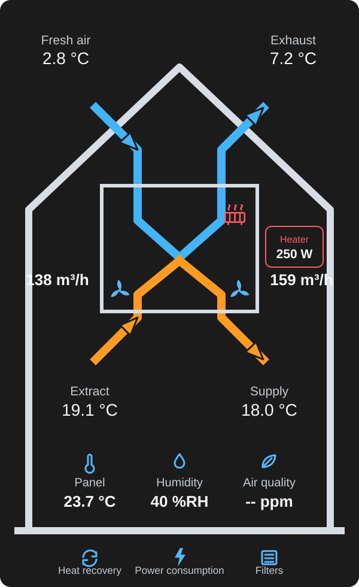

# Komfovent Domekt Card

Customizable Home Assistant Lovelace card for visualizing airflow through Komfovent Domekt ventilation units. It works with entities from the Home Assistant Modbus integration; no specific Modbus configuration is required.



## Features

- House and heat-exchanger airflow diagram with separate fresh/exhaust air paths.
- Configurable temperature, airflow, humidity, heat-recovery, and filter entities.
- Heat-recovery efficiency appears with an icon between the blue airflow paths; filter status replaces air quality.
- Heater power is shown separately. Total power consumption is not displayed.
- Visual editor for entity selection and custom labels.
- Labels default to English and can be changed to any language in the visual editor.
- Uses the Home Assistant theme and Material Design icons.

## Installation with HACS

This repository is installed as a custom HACS dashboard repository:

1. In Home Assistant, open **HACS → ⋮ → Custom repositories**.
2. Add `https://github.com/tobotak/komfovent-ha-card` and select the **Dashboard** category.
3. Install **Komfovent Domekt Card** and reload the browser.
4. Add the **Komfovent Domekt** card to a dashboard. Select the available entities in the visual editor.

## Manual installation

1. Copy `komfovent-ha-card.js` to `/config/www/komfovent-ha-card.js`.
2. Add `/local/komfovent-ha-card.js` as a **JavaScript Module** resource in Home Assistant.
3. Add a manual card with type `custom:komfovent-domekt-card`.

## Configuration

All entity fields are optional. Choose the sensors exposed by your Modbus setup in the card editor, or set them in YAML:

```yaml
type: custom:komfovent-domekt-card
outside_temperature: sensor.domekt_outdoor_temperature
exhaust_temperature: sensor.domekt_exhaust_temperature
extract_temperature: sensor.domekt_extract_temperature
supply_temperature: sensor.domekt_supply_temperature
extract_flow: sensor.domekt_extract_airflow
supply_flow: sensor.domekt_supply_airflow
panel_temperature: sensor.domekt_panel_temperature
humidity: sensor.domekt_humidity
heat_recovery: sensor.domekt_heat_recovery
heater_power: sensor.domekt_heater_power
filter: sensor.domekt_filter_status
```

The entity IDs above are examples. Values and units are read from the selected entities. Empty, unknown, or unavailable entities display `--`.

The `heat_recovery` value is shown as a percentage above the recovery icon, without a text label. The `filter` entity is shown in the bottom-right slot of the diagram. The card does not use a total power-consumption entity; `heater_power` remains available for the heater readout.

### Custom labels

The visual editor includes a text field for every label on the card. Enter any language, or clear a field to hide that label. You can also override labels in YAML:

```yaml
label_outside: Outside
label_exhaust: Exhaust
label_extract: Extract
label_supply: Supply
label_panel: Panel
label_humidity: Humidity
label_heater: Heater
label_filter: Filters
```

## License

Distributed under the MIT License. See [LICENSE](LICENSE).
